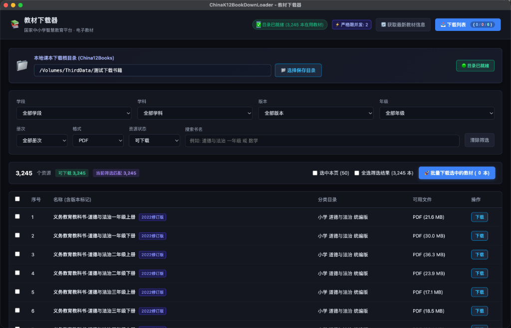
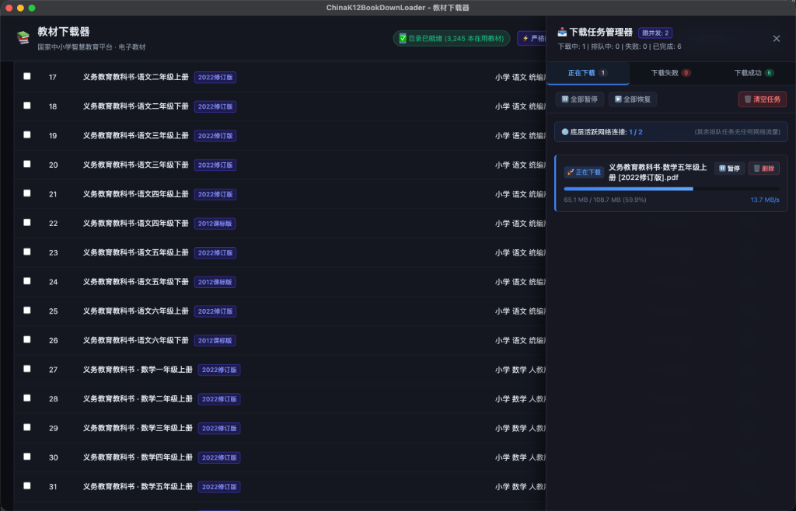

# ChinaK12BookDownLoader

> **国家中小学智慧教育平台 K12 教材可视化批量下载器与版本管理系统**  
> 界面精简直观、极简暗黑质感，支持按学段/学科/版本多维级联筛选、**一键全选当前筛选结果批量下载**、**实时下载管理器抽屉（带速率与进度）**、**本地同名版本跳过**、**官方同名多版本自动优选最新在用版**。

---

## 📷 界面预览与功能展示

| 教材主界面与多维级联筛选 | 实时下载管理器抽屉（限并发/速率/状态管理） |
| :---: | :---: |
|  |  |

---

## 🌟 核心特性

1. **可视化目录选择与安全防护**：
   - 原生文件夹选择器，选择目录后自动生效；
   - 未设置目录时强制禁止下载并高亮预警，避免下载到错误路径。

2. **一键全选与批量下载**：
   - 支持勾选当前页及“全选筛选结果”，可一键将数千本课本加入下载队列；
   - 勾选数量大于 100 本时提供大文件空间占用确认提醒。

3. **实时下载管理器（任务抽屉面板）**：
   - 顶部实时展示任务统计 `(正在下载 / 失败 / 已完成)`，点击即可滑出任务抽屉；
   - 支持暂停、恢复、重试、删除以及严格限并发调度与防封保护。

4. **同名版本秒级跳过与官方在用版优选**：
   - 包含版本号（如 `[2024修订版]`、`[2022修订版]`）的文件名；
   - 遇到官方同年级同学科同名多个文件时，以官方**最新在用版（最新时间戳）为准**；
   - 本地已存在且版本大小相符时，下载队列会自动标记为 `已存在(跳过)`，不耗费任何重复流量。

---

## 🚀 启动与使用方式

### 方式一：Node.js Web 模式（零配置秒开）

```bash
cd ChinaK12BookDownLoader
node server.js 8080
```
在浏览器打开：[http://127.0.0.1:8080](http://127.0.0.1:8080)

---

### 方式二：桌面客户端安装包（开箱即用）

进入 [Releases](https://github.com/scott20201225/ChinaK12BookDownLoader/releases) 页面直接下载对应系统的安装包：

| 操作系统 | 架构 | 安装包格式 |
| :--- | :--- | :--- |
| **macOS** | Apple Silicon (`arm64`) / Intel (`x64`) | `.dmg`、`.zip` |
| **Windows** | 64位 (`x64`) / 骁龙 ARM64 (`arm64`) | 安装包 (`-setup.exe`)、便携版 (`.zip`) |
| **Linux** | 64位 (`x64`) / 统信·麒麟·ARM64 (`arm64`) | `.AppImage`、`.deb`、`.tar.gz` |

---

### 方式三：开发者模式与本地打包

```bash
cd ChinaK12BookDownLoader
npm install

# 运行桌面版
npm start

# 构建本地安装包
npm run build:mac:arm64    # macOS Apple Silicon
npm run build:mac:x64      # macOS Intel
npm run build:win:x64      # Windows x64
npm run build:win:arm64    # Windows ARM64
npm run build:linux:x64    # Linux x64
npm run build:linux:arm64  # Linux ARM64
```

---

## 📁 课本存放目录规范

```
China12Books/
├── 小学/
│   ├── 数学/
│   │   └── 人教版-人民教育出版社/
│   │       └── 一年级/
│   │           └── 义务教育教科书·数学一年级上册 [2022修订版].pdf
│   └── 语文/
├── 初中/
├── 高中/
└── History/                          <-- 官方下架/更新的历史版本镜像归档
    └── 小学/
        └── 数学/
            └── 人教版-人民教育出版社/
                └── 一年级/
                    └── 义务教育教科书·数学一年级上册 [2012旧课标版].pdf
```
